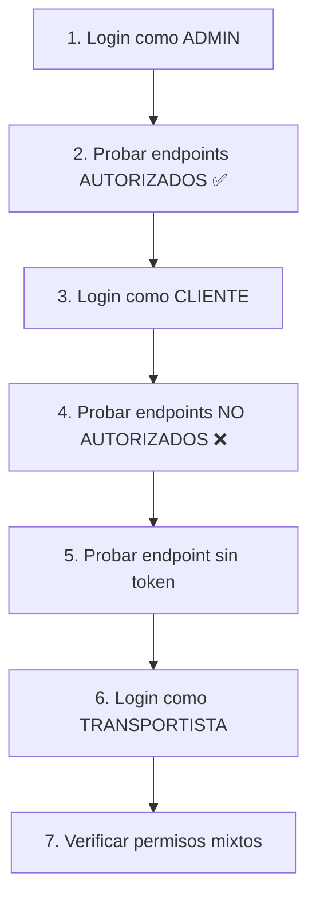

# 🧪 Guía de Pruebas con Postman - Autenticación y Autorización

## 📋 Contenido

1. [Importar Colección](#importar-colección)
2. [Matriz de Autorización](#matriz-de-autorización)
3. [Casos de Prueba](#casos-de-prueba)
4. [Usuarios de Prueba](#usuarios-de-prueba)
5. [Respuestas Esperadas](#respuestas-esperadas)

---

## 📥 Importar Colección

1. Abre Postman
2. Click en **Import** (esquina superior izquierda)
3. Selecciona el archivo `POSTMAN_COLLECTION.json`
4. La colección "TPI Backend - Keycloak Auth" aparecerá en tu workspace

---

## 🔐 Matriz de Autorización por Rol (según enunciado TPI)

### **Roles del Sistema:**

- **CLIENTE**: Registra pedidos, consulta estado, ve costo/tiempo
- **ADMIN** (Operador/Administrador): Gestiona todo el sistema
- **TRANSPORTISTA**: Ve tramos asignados, registra inicio/fin de viaje

---

### Servicio de Logística (Gestión operativa)

| Endpoint | Método | CLIENTE | TRANSPORTISTA | ADMIN | Razón |
|----------|--------|---------|---------------|-------|-------|
| `/api/logistica/camiones` | GET | ❌ 403 | ✅ 200 | ✅ 200 | Transportista ve camiones para asignaciones |
| `/api/logistica/camiones` | POST | ❌ 403 | ❌ 403 | ✅ 201 | Solo Admin carga camiones |
| `/api/logistica/camiones/{id}` | PUT | ❌ 403 | ❌ 403 | ✅ 200 | Solo Admin actualiza camiones |
| `/api/logistica/camiones/{id}` | DELETE | ❌ 403 | ❌ 403 | ✅ 204 | Solo Admin elimina |
| `/api/logistica/depositos` | GET | ❌ 403 | ❌ 403 | ✅ 200 | Solo Admin gestiona depósitos |
| `/api/logistica/depositos` | POST | ❌ 403 | ❌ 403 | ✅ 201 | Solo Admin carga depósitos |
| `/api/logistica/ubicaciones` | GET | ❌ 403 | ❌ 403 | ✅ 200 | Solo Admin gestiona ciudades |
| `/api/logistica/ubicaciones` | POST | ❌ 403 | ❌ 403 | ✅ 201 | Solo Admin carga ciudades |
| `/api/logistica/tarifas` | GET | ❌ 403 | ❌ 403 | ✅ 200 | Solo Admin ve tarifas |
| `/api/logistica/tarifas` | POST/PUT | ❌ 403 | ❌ 403 | ✅ 200 | Solo Admin modifica tarifas |
| `/api/logistica/rutas` | GET | ❌ 403 | ✅ 200 | ✅ 200 | Transportista ve rutas asignadas |
| `/api/logistica/rutas` | POST | ❌ 403 | ❌ 403 | ✅ 201 | Solo Admin asigna rutas |
| `/api/logistica/tramos` | GET | ❌ 403 | ✅ 200 | ✅ 200 | Transportista ve tramos asignados |
| `/api/logistica/tramos` | POST | ❌ 403 | ❌ 403 | ✅ 201 | Solo Admin crea tramos |

### Servicio de Seguimiento (Operaciones de clientes y transportistas)

| Endpoint | Método | CLIENTE | TRANSPORTISTA | ADMIN | Razón |
|----------|--------|---------|---------------|-------|-------|
| `/api/seguimiento/solicitudes` | GET | ✅ 200 | ✅ 200 | ✅ 200 | Cliente consulta estado, Transportista ve asignados |
| `/api/seguimiento/solicitudes` | POST | ✅ 201 | ❌ 403 | ✅ 201 | **Cliente registra pedidos de traslado** |
| `/api/seguimiento/solicitudes/{id}` | GET | ✅ 200 | ✅ 200 | ✅ 200 | Cliente ve su solicitud con costo/tiempo |
| `/api/seguimiento/solicitudes/{id}` | PUT | ❌ 403 | ✅ 200 | ✅ 200 | **Transportista registra inicio/fin**, Admin asigna rutas |
| `/api/seguimiento/solicitudes/{id}` | DELETE | ❌ 403 | ❌ 403 | ✅ 204 | Solo Admin elimina |
| `/api/seguimiento/contenedores` | GET | ✅ 200 | ✅ 200 | ✅ 200 | Todos ven contenedores |
| `/api/seguimiento/contenedores` | POST | ❌ 403 | ❌ 403 | ✅ 201 | Solo Admin crea contenedores |
| `/api/seguimiento/clientes` | * | ❌ 403 | ❌ 403 | ✅ 200 | Solo Admin gestiona clientes |

---

## 👥 Usuarios de Prueba

| Usuario | Contraseña | Rol | Uso |
|---------|------------|-----|-----|
| `cliente01` | `Hola123` | **cliente** | Cliente que solicita transporte |
| `admin01` | `Clave123` | **admin** | Administrador del sistema |
| `transportista01` | `Clave123` | **transportista** | Operador de camiones |

---

## 🧪 Casos de Prueba Paso a Paso

### **Caso 1: Autenticación Exitosa (200 OK)**

1. Ve a la carpeta `1. Autenticación`
2. Ejecuta **"Login como CLIENTE"**
3. ✅ Deberías ver:
   ```json
   {
     "access_token": "eyJhbGc...",
     "expires_in": 300,
     "refresh_expires_in": 1800,
     "token_type": "Bearer"
   }
   ```
4. El token se guarda automáticamente en la variable `access_token_cliente`
5. En la consola de Postman verás:
   ```
   ✅ Token de CLIENTE guardado
   👤 Usuario: cliente01
   🎭 Roles: ["cliente"]
   ⏰ Expira en: 300 segundos
   ```

**Repite** con "Login como ADMIN" y "Login como TRANSPORTISTA"

---

### **Caso 2: Sin Autenticación (401 Unauthorized)**

1. Ve a `2. Logística Service > Camiones`
2. Ejecuta **"❌ Listar Camiones (SIN TOKEN)"**
3. ❌ Deberías recibir **401 Unauthorized**
   ```json
   {
     "error": "Unauthorized",
     "message": "Full authentication is required"
   }
   ```

---

### **Caso 3: Autorización Exitosa (200 OK)**

1. **Primero** ejecuta "Login como ADMIN" para obtener el token
2. Ve a `2. Logística Service > Camiones`
3. Ejecuta **"✅ Listar Camiones (ADMIN)"**
4. ✅ Deberías recibir **200 OK** con datos:
   ```json
   [
     {
       "id": 1,
       "dominio": "AB123CD",
       "capacidadPesoKg": 10000.0,
       "disponible": true
     },
     ...
   ]
   ```

---

### **Caso 4: Sin Autorización (403 Forbidden)**

1. **Primero** ejecuta "Login como CLIENTE" para obtener el token de cliente
2. Ve a `2. Logística Service > Camiones`
3. Ejecuta **"❌ Listar Camiones (CLIENTE)"**
4. ❌ Deberías recibir **403 Forbidden**
   ```json
   {
     "error": "Forbidden",
     "message": "Access Denied"
   }
   ```

**Razón:** El rol CLIENTE no tiene permiso para ver camiones

---

### **Caso 5: Crear Recurso con Rol Correcto (201 Created)**

1. **Primero** ejecuta "Login como ADMIN"
2. Ve a `2. Logística Service > Camiones`
3. Ejecuta **"✅ Crear Camión (ADMIN)"**
4. ✅ Deberías recibir **200 OK** o **201 Created**:
   ```json
   {
     "id": 4,
     "dominio": "ZZ999XX",
     "capacidadPesoKg": 12000.0,
     "disponible": true
   }
   ```

---

### **Caso 6: Crear Recurso con Rol Incorrecto (403 Forbidden)**

1. **Primero** ejecuta "Login como TRANSPORTISTA"
2. Ve a `2. Logística Service > Camiones`
3. Ejecuta **"❌ Crear Camión (TRANSPORTISTA)"**
4. ❌ Deberías recibir **403 Forbidden**

**Razón:** Solo ADMIN puede crear camiones

---

### **Caso 7: Flujo Completo de CLIENTE (según enunciado)**

**El CLIENTE debe poder:**
1. ✅ Registrar pedido de traslado
2. ✅ Consultar estado de su contenedor
3. ✅ Ver costo y tiempo estimado

**Pasos:**

1. **Login como CLIENTE**
2. Ve a `3. Seguimiento Service > Solicitudes`
3. Ejecuta **"✅ Crear Solicitud (CLIENTE)"** → Debe devolver **201 Created**
   ```json
   {
     "id": 4,
     "numero": "SOL-2024-004",
     "estado": "PENDIENTE",
     "costoEstimado": 18000.00,
     "tiempoEstimadoMin": 520
   }
   ```
4. Ejecuta **"✅ Listar Solicitudes (CLIENTE)"** → Debe devolver **200 OK** con sus solicitudes
5. Ejecuta **"✅ Listar Contenedores (TODOS)"** → Debe devolver **200 OK**

**El CLIENTE NO puede:**
- ❌ Ver camiones: `GET /api/logistica/camiones` → **403 Forbidden**
- ❌ Ver depósitos: `GET /api/logistica/depositos` → **403 Forbidden**  
- ❌ Ver tarifas: `GET /api/logistica/tarifas` → **403 Forbidden**
- ❌ Actualizar solicitudes: `PUT /api/seguimiento/solicitudes/{id}` → **403 Forbidden**

---

### **Caso 8: Flujo Completo de TRANSPORTISTA (según enunciado)**

**El TRANSPORTISTA debe poder:**
1. ✅ Ver tramos asignados
2. ✅ Registrar inicio y fin de tramo
3. ✅ Ver camiones

**Pasos:**

1. **Login como TRANSPORTISTA**
2. Ejecuta `GET /api/logistica/tramos` → **200 OK** (ve sus tramos asignados)
3. Ejecuta `GET /api/logistica/camiones` → **200 OK** (ve camiones disponibles)
4. Ejecuta `PUT /api/seguimiento/solicitudes/{id}` → **200 OK** (registra inicio/fin de viaje)

**El TRANSPORTISTA NO puede:**
- ❌ Crear solicitudes: `POST /api/seguimiento/solicitudes` → **403 Forbidden**
- ❌ Crear camiones: `POST /api/logistica/camiones` → **403 Forbidden**
- ❌ Modificar depósitos: `POST /api/logistica/depositos` → **403 Forbidden**
- ❌ Modificar tarifas: `PUT /api/logistica/tarifas` → **403 Forbidden**

---

### **Caso 9: Flujo Completo de ADMIN (según enunciado)**

**El ADMIN (Operador) debe poder hacer TODO:**
1. ✅ Cargar y actualizar ciudades, depósitos, tarifas, camiones
2. ✅ Asignar camiones a tramos
3. ✅ Consultar rutas tentativas
4. ✅ Gestionar clientes

**Pasos:**

1. **Login como ADMIN**
2. **Gestión de Logística:**
   - `POST /api/logistica/camiones` → **201 Created** (carga camión)
   - `POST /api/logistica/depositos` → **201 Created** (carga depósito)
   - `POST /api/logistica/ubicaciones` → **201 Created** (carga ciudad)
   - `PUT /api/logistica/tarifas` → **200 OK** (modifica tarifa)
3. **Gestión de Solicitudes:**
   - `GET /api/seguimiento/solicitudes` → **200 OK** (consulta rutas)
   - `PUT /api/seguimiento/solicitudes/{id}` → **200 OK** (asigna ruta)
4. **Gestión de Clientes:**
   - `GET /api/seguimiento/clientes` → **200 OK**
   - `POST /api/seguimiento/clientes` → **201 Created**

**El ADMIN tiene acceso TOTAL a todos los endpoints.**

---

## 📊 Tabla Resumen de Respuestas HTTP

| Código | Significado | Cuándo ocurre |
|--------|-------------|---------------|
| **200 OK** | Éxito | Operación exitosa con datos |
| **201 Created** | Recurso creado | POST exitoso |
| **204 No Content** | Éxito sin datos | DELETE exitoso |
| **401 Unauthorized** | Sin autenticación | No se envió token o token inválido/expirado |
| **403 Forbidden** | Sin autorización | Token válido pero rol sin permisos |
| **404 Not Found** | No encontrado | Recurso no existe |

---

## 🔍 Verificar Roles en el Token

Para ver qué roles tiene un token JWT:

1. Ejecuta cualquier login (ej: Login como CLIENTE)
2. Copia el `access_token` de la respuesta
3. Ve a [jwt.io](https://jwt.io)
4. Pega el token
5. En el payload busca:
   ```json
   {
     "resource_access": {
       "tpi-backend-client": {
         "roles": ["cliente"]  // ← Aquí están los roles
       }
     }
   }
   ```

---

## ⚡ Tips de Uso

### Auto-guardar Tokens

La colección ya tiene scripts que **automáticamente** guardan los tokens cuando haces login. Solo necesitas:

1. Ejecutar el login correspondiente
2. El token se guarda en la variable de colección
3. Los demás requests usan automáticamente ese token

### Cambiar de Usuario Rápidamente

1. Ejecuta el login del usuario que quieres usar
2. Todos los requests marcados con ese rol usarán automáticamente el token correcto

### Ver Variables de la Colección

En Postman:
1. Click derecho en la colección
2. **Edit**
3. Tab **Variables**
4. Verás los 3 tokens guardados

---

## 🚀 Flujo de Prueba Recomendado



### Orden sugerido:

1. **Login como ADMIN** → Probar acceso completo
2. **Login como CLIENTE** → Probar restricciones en camiones
3. **Login como TRANSPORTISTA** → Probar restricciones en creación
4. **Sin token** → Probar autenticación requerida
5. **Token expirado** → Esperar 5 minutos y reusar un token viejo

---

## 📝 Notas Importantes

- Los tokens **expiran en 5 minutos** (300 segundos)
- Si recibes 401, vuelve a hacer login para refrescar el token
- Los datos seed se cargan automáticamente al iniciar los servicios
- Si los contenedores se reinician (no recrean), los datos H2 se pierden
- Para recargar datos: `docker compose up -d --force-recreate logistica-service seguimiento-service`

---

## 🐛 Troubleshooting

### ❌ Recibo 401 en todos los requests

**Causa:** Token no válido o expirado

**Solución:** Ejecuta de nuevo el login correspondiente

### ❌ Recibo 500 Internal Server Error

**Causa:** Servicios no están corriendo o hay error en la app

**Solución:**
```bash
cd infra
docker compose logs api-gateway --tail=50
docker compose logs logistica-service --tail=50
```

### ❌ Recibo arrays vacíos `[]`

**Causa:** Base de datos H2 sin datos

**Solución:**
```bash
cd infra
docker compose up -d --force-recreate logistica-service seguimiento-service
sleep 20  # Esperar a que carguen los datos
```

### ❌ Connection refused

**Causa:** Servicios no están iniciados

**Solución:**
```bash
cd infra
docker compose up -d
docker compose ps  # Verificar que todos estén "Up"
```

---

## 📚 Referencias

- [Documentación Keycloak](https://www.keycloak.org/docs/latest/)
- [Spring Security OAuth2 Resource Server](https://docs.spring.io/spring-security/reference/servlet/oauth2/resource-server/)
- [JWT.io - Decodificador de tokens](https://jwt.io)

---

**¡Listo para probar! 🎉**

Empieza con la carpeta "1. Autenticación" y sigue el orden de las carpetas.
